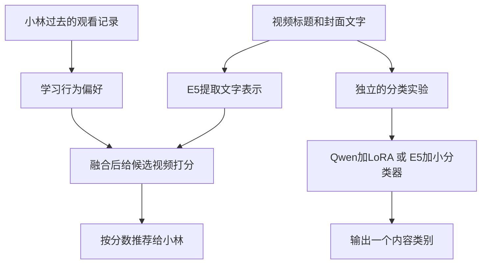
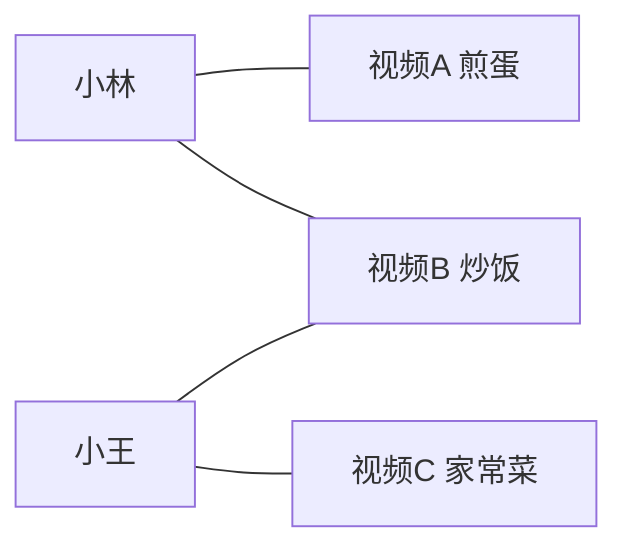

# 用大白话理解 ClipCompass 的模型与目标

先从一个问题开始：**小林过去经常长时间看做饭视频。现在有一条没有训练期观看记录的番茄炒蛋视频，我们凭什么把它推荐给小林？**

ClipCompass 想研究的就是这件事：结合视频文字和用户过去的观看行为，让缺少历史记录的内容也能得到有依据的推荐分数，再检查这样做是否真的排得更好。

本文假设你刚接触机器学习，不需要先懂矩阵和公式。小林及其观看故事都是教学示例，实际实验使用 KuaiRec 的真实公开日志。涉及实测结果时会明确说明。

第一次可以顺着读到“把一次推荐完整串起来”；理解主流程后，再读 Qwen、LoRA 和实验结果。公式、张量尺寸、超参数与代码解释放在配套的[技术详解](TECHNICAL_WALKTHROUGH.md)。

## 阅读导航

- [先分清项目中的两个任务](#先分清项目中的两个任务)
- [先认识几个绕不开的词](#先认识几个绕不开的词)
- [E5 把文字变成可计算的数字](#e5-把文字变成可计算的数字)
- [文字相似为什么还不够](#文字相似为什么还不够)
- [ID 向量从观看反馈中学习](#id-向量从观看反馈中学习)
- [LightGCN 利用共同观看关系](#lightgcn-利用共同观看关系)
- [门控决定两种表示怎样混合](#门控决定两种表示怎样混合)
- [BPR 教模型把正例排在前面](#bpr-教模型把正例排在前面)
- [InfoNCE 给同一视频的两种表示配对](#infonce-给同一视频的两种表示配对)
- [把一次推荐完整串起来](#把一次推荐完整串起来)
- [Qwen 按指令给文字分类](#qwen-按指令给文字分类)
- [LoRA 用少量参数适配分类任务](#lora-用少量参数适配分类任务)
- [这台电脑为什么能完成实验](#这台电脑为什么能完成实验)
- [简单方法为什么必须比较](#简单方法为什么必须比较)
- [怎样判断模型有没有学好](#怎样判断模型有没有学好)
- [实际遇到的问题和处理办法](#实际遇到的问题和处理办法)
- [现有结果应该怎样理解](#现有结果应该怎样理解)
- [用自己的话复述这个项目](#用自己的话复述这个项目)

## 先分清项目中的两个任务

项目有推荐和分类两条实验线，它们回答的问题不同。

| 任务 | 吃进去什么 | 吐出来什么 | 需要回答的问题 |
|---|---|---|---|
| 推荐 | 某个用户的观看历史、候选视频的标题和封面文字 | 按分数排好的一组视频 | 哪些内容应该优先给这个用户看 |
| 分类 | 一条视频的标题和封面文字 | 八类中的一个类别 | 这段文字对应哪类内容 |

同一条“番茄炒蛋的做法”，分类可以给它“美食”标签。但是小林爱看，小周可能不爱看。**分类说明内容属于什么，推荐还需要考虑具体用户。**



当前推荐使用 E5 和图推荐模型。Qwen 分类结果没有接入推荐分数，因此不能说“Qwen 微调让推荐效果提升了”。

另外，项目读取的是标题和数据集提供的封面文字，没有看视频画面。这里的“理解内容”有明确范围：用文字提供内容线索。

## 先认识几个绕不开的词

**模型就是一套能计算输出的规则，其中有很多数值可以调整。** 比如输入用户和视频，输出一个匹配分数。训练就是利用例子调整这些数值；推理就是使用已经调好的数值计算新输入。

可以把参数想成设备上的许多旋钮。训练会根据结果不断调旋钮，但模型并不是在每次使用时自动越用越聪明，只有执行更新过程才会改变参数。

| 词 | 大白话解释 | 在本项目中的例子 |
|---|---|---|
| 特征 | 提供给计算过程的线索 | 标题、观看记录、文字向量 |
| 向量 | 按固定顺序排列的一组数字 | 一条标题对应 384 个数 |
| 参数 | 训练时可以调整的内部数字 | 用户表示、文字投影、LoRA 参数 |
| 标签 | 用来告诉训练过程期望结果的答案或反馈 | 长观看反馈、原始内容类别 |
| 损失 | 衡量这次输出离训练要求有多远 | 正例分数低于负例时惩罚更大 |
| 训练 | 根据损失调整参数 | 学习小林与哪些视频更匹配 |
| 推理 | 用已有参数计算结果 | 给候选视频打分或输出类别 |
| 预训练 | 模型作者先在其他大量数据上训练 | 下载的 E5 和 Qwen 已有参数 |
| 冻结 | 当前实验不再调整这部分参数 | E5 只负责提取表示 |
| 微调 | 从已有模型出发，用当前任务样本进一步调整 | 用标题和类别训练 Qwen 的 LoRA |

这里还容易混淆一点：**模型产生的表示，和模型内部的参数，不完全是同一种东西。** E5 的参数是一套固定的文字处理规则；它遇到不同标题，会算出不同的 384 维向量。

## E5 把文字变成可计算的数字

你说的“BERT 把自然语言变成向量”，在项目里具体对应 E5。E5 是一个已经训练好的文字编码器，其本地实现使用 BERT 类型结构。

### 它接收什么

例如接收：

```text
番茄炒蛋的做法和烹饪技巧
```

### 它做什么

它经过几个步骤，把这句话变成一组数字：

1. **切成文字单元。** 分词器把文字切成 token，一个 token 不一定是一个汉字或一个完整单词。
2. **根据上下文处理这些单元。** “苹果手机”与“苹果种植”中的“苹果”处于不同上下文，模型可以利用周围文字形成不同表示。
3. **汇总整句话。** 本项目把有效文字位置的表示平均，排除为了凑齐批次长度补上的空位。
4. **统一表示的长度尺度。** 让比较更关注向量方向，减少单纯数字整体变大造成的影响。

### 它输出什么

一条 384 维向量，也就是 384 个浮点数。

可以把它想成内容在“语义地图”上的位置。地图的直觉是：相关意思有机会被放到相近的位置，方便后续模型比较。真实地图有 384 个维度，我们没法像平面地图那样直接看。

**384 个数不是 384 个标签。** 不能说第一维就是美食、第二维就是舞蹈；大部分维度没有这种直接解释，意义分散在整组数里。相似表达也不保证每次都被正确识别。

E5 本身不直接输出“小林会喜欢它”或“美食”。它输出的是可以继续用于匹配、分类和其他计算的文字表示。

本项目把标题与封面文字一起编码，E5 参数冻结。也就是说，我们使用它已有的文字表示能力，没有在这台电脑上重新训练整个 E5。

## 文字相似为什么还不够

假设小林长看过“家常菜入门”“鸡蛋怎么炒更嫩”“厨房技巧”。把这些内容的文字向量求平均，可以得到一份很粗的兴趣摘要。

然后拿新标题的向量与这份摘要比较，这就是 E5 历史画像基线。它的想法很直观：过去常看什么主题，就继续找接近的主题。

但它会遇到实际问题。两条视频都在讲番茄炒蛋，一条干净利落，一条拖沓难懂；文字主题接近，小林的观看反馈却可能不同。小林也可能同时喜欢做饭和足球，把所有兴趣平均后，两种偏好会混在一起。

所以要把两个问题分开：

- 文字表示回答“这些内容在说什么，彼此是否相关”。
- 推荐学习回答“根据过去反馈，这个用户更可能偏好哪一个”。

这也是为什么项目在 E5 之外还研究了行为模型。

## ID 向量从观看反馈中学习

用户和视频在数据里都有 ID，比如用户 17、视频 203。ID 只是编号，203 不意味着视频更好，也不意味着它属于某个主题。

最基础的协同推荐模型，会给每个用户和视频各分配一行可以训练的数字。本项目使用 32 个数。这就是 ID embedding，可以理解为“通过反馈逐步写出来的用户或内容档案”。

初始化时，这些数是随机的。训练读到小林对哪些视频长看、对哪些已经曝光的视频观看很短，就调整小林和这些视频的数字，让它们算出的匹配分数更符合反馈。

**ID 向量的内容来自训练，不能仅靠编号自动知道用户兴趣或视频主题。** 没有训练行为的新视频，对应的 ID 向量就缺少依据。

一个最基础的版本叫矩阵分解，缩写 MF。它直接拿用户向量和内容向量计算匹配分数。项目中的 BPR-MF 就是用后面会解释的 BPR 目标训练这个版本。

| 表示 | 从哪里获得信息 | 主要用途 |
|---|---|---|
| E5 文字向量 | 已训练好的编码器加当前文字 | 提供内容语义 |
| 内容 ID 向量 | 当前内容收到的训练反馈 | 提供协同偏好线索 |
| 用户 ID 向量 | 当前用户的训练反馈 | 提供个性化偏好线索 |

## LightGCN 利用共同观看关系

LightGCN 是在行为推荐里进一步利用“谁长看了什么”的模型。可以先不记它的全称，先看这个关系图。

教学例子中：小林长看视频 A 和 B，小王长看 B 和 C。用户之间没有直接连线，两个人通过共同内容 B 联系起来。



LightGCN 让相连的用户和内容互相汇总信息，再沿图传播。小林可以从 A、B 获得内容侧线索；B 又连接小王，使共同观看关系成为可学习的协同信号。

这里没有社交好友信息，也没有直接建“相似用户之间的边”。实际图里只有用户和内容两种节点，所以叫二部图。

本项目传播两层，并把原始表示及两次传播后的表示平均。聚合时还做了度数归一化，可以理解为：一个视频连接很多用户时，不让它仅靠邻居数量就把其他信号完全盖过去。

LightGCN 最后仍输出用户和内容的数字向量。它不会输出一段“因为小王喜欢，所以推荐给小林”的文字解释；上面的故事只是帮助理解信息来源。

**它的主要盲区是没有训练行为的新内容。** 新视频没有图上的正例连接，协同图很难给它有效表示。下一步就要利用 E5 的文字线索。

## 门控决定两种表示怎样混合

现在同一个内容有两份信息：

- 行为表示：哪些用户长看过它。
- 文字表示：标题和封面文字提供什么语义。

两份表示的长度不同，图模型是 32 维，E5 是 384 维。项目先训练一个小的变换层，把 384 个数变成适合当前推荐任务的 32 个数。这个过程叫投影，不能理解成随手删掉前面或后面的数字。

随后，门控学习一个混合比例。假设某条内容的比例是 0.7，就表示将 70% 的图表示与 30% 的文字投影混合。这个数字只是教学举例，不是实际某条内容的测量值。

它像一个混音旋钮：可以调两路信号的占比。不过，**这个旋钮由训练反馈学出来，不保证它真能判断哪种信息更可靠。** 本项目每个内容对应一个比例，也不是换一个请求用户就重新计算一套比例。

对于没有训练正例的内容，代码强制关闭 ID 分支，只使用文字投影。这样至少可以避免随机 ID 向量干扰冷内容分数。

用户侧还会加入过去正例标题的语义摘要。于是最终匹配同时利用用户的行为表示和历史文字线索。

冷启动的意思就是缺少可用训练历史。这里专门研究内容冷启动，小林本人有过去的行为；完全没有历史的新用户是另一个尚未验证的问题。

## BPR 教模型把正例排在前面

前面说模型要学习，究竟按什么要求学习？BPR 给它一个简单任务：**同一个用户的一对内容中，把正例排在负例前面。**

例如，日志里小林对视频 A 有长观看反馈，对已经曝光的视频 B 观看很短。训练希望 A 的分数高于 B。

```text
若A得1分，B得3分：顺序不符合这条训练反馈，惩罚较大。
若A得3分，B得1分：顺序更符合这条训练反馈，惩罚较小。
```

模型根据惩罚调整参数，再看下一批正负配对。这就是成对排序学习。分数只用于相对次序，3 分不等于喜欢概率 30% 或 100%。

`watch_ratio` 是观看时长除以视频时长。例如10秒的视频累计观看20秒，比值就是2，可能包含重复观看。项目把 `watch_ratio >= 2` 作为长观看正例，把已曝光且 `watch_ratio < 1` 作为训练负例，中间区间不参与正负对采样。长观看是偏好代理，不能直接等同于真实喜欢；没曝光过的内容也没有被直接认定为不喜欢。

**BPR 是训练要求，不是另一个读标题的模型。** 同一个目标可以用来训练 MF、LightGCN 或加入文字的融合模型。

代码中的 60 epochs 实际表示 60 轮采样更新，每轮每个合格用户抽 128 组正负对，执行一次整体参数更新；不表示把全部曝光记录完整学了 60 遍。

## InfoNCE 给同一视频的两种表示配对

同一个视频有行为表示和文字表示。它们虽然属于同一个内容，却不一定处在容易互相对应的数字空间里。

可以想成一张视频有两张说明卡：一张写着它的观看关系摘要，一张写着它的标题语义摘要。我们知道这两张卡属于同一个视频，希望模型能把这对关系对应起来。

训练时，把一批视频的两种表示放在一起：

- 同一视频的行为表示与文字表示，是正确配对。
- 当前批次中其他视频的文字表示，是用于区分的其他选项。

InfoNCE 会鼓励正确配对相对更接近。这样的目标叫对比学习；配对答案来自视频身份，不需要再请人逐对标注。

这里不是“把所有同属美食的内容都当正例”，而是以同一个视频 ID 配对。两条不同的做饭视频可能很像，却被当作不同选项，这就是可能出现的假负例问题。

另一个问题是，文字相似和用户行为相似未必一致。强行对齐可能帮助模型，也可能干扰推荐。因此项目保留了加与不加 InfoNCE 的版本进行比较，实际效果必须看实验。

## 把一次推荐完整串起来

回到小林和番茄炒蛋视频，可以把整个过程分成准备、学习和使用。

**准备数据时**，先整理小林过去的观看记录，区分长观看正例与已曝光低观看负例。标题和封面文字则交给冻结的 E5，得到文字向量。

**训练时**，LightGCN 利用用户与内容的正例关系学习行为表示，小变换层学习怎样把文字表示用于推荐，门控学习混合比例。BPR 让同用户正例尽量排在负例前；SSL 版本还增加两种表示的配对目标。

**使用时**，拿已经算好的小林向量，与候选视频向量计算匹配分数，再按分数排序。小林的表示包含过去行为与正例文字的线索；缺少训练行为的视频使用文字分支产生内容表示。

```text
历史观看记录 → 学出用户偏好
新内容的文字 → 算出内容表示
两者计算匹配分数 → 过滤已曝光内容 → 排序返回
```

在真实实验里，“新内容”是人为留出的 314 个目录内容：训练时隐藏其行为，用来模拟冷启动。当前服务加载固定目录的向量，不会因为用户在线上传一条新视频就自动完成编码和更新。

同样，项目试验的九种方法是可比较的候选方案，不是把九个模型全部串起来执行。服务用的是其中一个保存好的推荐 checkpoint。

## Qwen 按指令给文字分类

Qwen 属于大语言模型。这里给它一段分类指令和标题，让它预测接下来应该输出的类别代码。

输入示意：

```text
根据标题判断类别，只输出一个代码。
a=其他；b=情感；c=时尚；d=明星娱乐；
e=民生资讯；f=美食；g=舞蹈；h=颜值。

标题：番茄炒蛋的做法和烹饪技巧
类别代码：
```

训练希望它接着输出 `f`，表示美食。实际模型仍可能答错。

为什么用一个字母？因为每个代码都能对应一个 token，回复长度容易控制，也方便比较八个类别。当前实验只训练这个类别回复位置，没有训练长篇解释或自由生成的完整答案。

读标题时，Qwen 会计算许多内部向量，但这里使用它的目的是输出类别代码。E5 则被用作文字表示工具：它的输出要交给后面的推荐模型或分类器继续处理。

| 对比 | E5 在项目中的用法 | Qwen 在项目中的用法 |
|---|---|---|
| 主要输入 | 标题与封面文字 | 分类指令与标题文字 |
| 我们取出的输出 | 384 个数字 | 一个类别代码的预测 |
| 输出用途 | 推荐特征或分类特征 | 八类内容分类 |
| 当前是否调整本体参数 | 冻结 | 本体冻结，只训练 LoRA |

Qwen 当前没有看视频画面，也没有为用户生成推荐理由。独立分类实验的结果不能拿来解释推荐指标变化。

## LoRA 用少量参数适配分类任务

预训练 Qwen 已经有大量参数，通用能力来自模型作者先前的训练。我们希望它更适应当前的八类分类要求，但在这台电脑上更新整个模型成本较高。

LoRA 的做法是：**保留原有大部分计算规则，在部分位置加上一小组可以训练的修正参数。**

可以把原模型想成一套已有的计算流程，LoRA 是少量可调的补充规则。输入仍然经过原模型，但补充规则可以改变中间计算，进而影响最后输出哪个类别。

它不是给模型外挂一个可以搜索的知识库，也不是把原模型压缩成一个小模型。基础模型仍然需要加载和计算。

本项目使用约 5 亿参数的 Qwen2.5-0.5B，只在最后四层的部分注意力投影中添加 LoRA，实际训练 90,112 个参数。这减少了需要更新和保存训练状态的数字数量。

“rank=8”描述这些补充参数的结构大小，不是八个类别。类别数恰好也是八，二者没有这个对应关系。

### 几个相关词怎样区分

| 词 | 大白话解释 | 项目中是否实际做了 |
|---|---|---|
| Prompt | 把要求写进输入，比如“只输出类别代码” | 是 |
| SFT | 给模型输入与期望回复，依据答案训练 | 是，回复只有一个类别 token |
| Fine-tuning | 在已有模型基础上继续针对任务调整 | 是，使用 LoRA 适配 |
| LoRA | 只训练一小组低秩补充参数的方法 | 是 |
| Continuous Pretrain | 用额外语料继续做基础语言模型训练 | 没有 |
| 蒸馏 | 用教师模型的输出或表示教学生模型 | 当前真实研究实验没有 |

SFT 描述怎么提供监督，LoRA 描述更新哪些参数，因此它们可以同时使用。

## 这台电脑为什么能完成实验

这台电脑只有 CPU，没有 NVIDIA GPU。能完成当前实验，主要靠任务规模和计算方式的取舍，不是因为大模型训练突然变得不需要资源。

**E5 先算一次文字表示。** 它在当前实验中冻结，同一条标题没变时，可以复用已经算好的向量。无需每次推荐训练更新都重新编码标题。

**推荐模型使用较小的向量。** 用户和内容最终都是 32 个数，正例关系用稀疏图存储。虽然原始曝光有约 467 万条，用户和内容目录只有 1,411 人与 3,327 个内容，图里的训练正边约 13.38 万条。

**Qwen 只训练后四层的 LoRA。** 前二十层冻结。相同输入在冻结部分产生的中间结果不随后面的 LoRA 更新而变，所以可以缓存，下次重复遇到该输入就直接取出。

**公共指令也可以复用部分计算。** 样本共有的指令和代码表，在冻结前层中的计算可以复用；标题相关部分和含 LoRA 的后四层仍需按要求计算。缓存保存的是可复用的中间结果，不是预先存好的分类答案。

代码做了完整路径与缓存路径的数值检查，也检查了 LoRA 收到训练梯度。现有实现针对当前 CPU、模型和依赖版本，不能直接宣称换任意模型都适用。项目没有独立测量有无缓存的加速倍数。

## 简单方法为什么必须比较

做机器学习不能只问“复杂模型能不能跑”，还要问“有没有更简单的办法已经做得更好”。这些简单或成熟的参照叫基线。

### 热门与平滑长观看率

热门计数看一条内容获得多少训练正例，但曝光越多，正例数可能自然越高。因此另一个基线看长观看正例占曝光的比例。

还要处理小样本：某视频只曝光一次，恰好得到一个正例，不能就认定它真的有 100% 的稳定表现。平滑长观看率把小样本结果适当拉向全体内容的平均水平，降低这种波动。

这类方法不考虑小林是谁，对每个用户给同一内容相同分数，却可能是很强的对照。当前实验中，平滑长观看率的混合候选排序指标就高于所有当前神经模型。

### TF-IDF

TF-IDF 是一种文字特征方法。它把文字中出现的片段变成数字，并让有区分度的片段更突出。本项目用单字、相邻双字和三字片段。

它较偏重词面出现了什么。E5 则使用预训练编码器生成上下文语义表示，所以有机会处理不同说法间的相关性。但更复杂的表示不保证在任何任务上都更好。

### EASE

EASE 从用户对哪些内容有长观看正例的表格里，学习内容之间的线性关系。例如某些内容经常与同一批用户相关，就可以成为预测其他内容偏好的线索。

它会同时考虑多条内容的关系和正则约束，不是简单数“两个视频一起出现几次”。它不需要像 LightGCN 那样反复传播图，用于检查强线性协同方法能达到什么水平。

### E5 加逻辑回归

逻辑回归在这里可以理解为一个小分类器：接收 E5 给出的 384 个数，分别为八个类别算分，选择分数最高的类别。

E5 负责提取文字表示，小分类器只学习“怎样利用这些表示区分类别”。这样要训练的部分很小。在当前数据和预算下，它的分类指标高于 Qwen LoRA。

这些方案各自运行、分别评测。推荐方法之间比较推荐指标，分类方法之间比较分类指标，不能把两个任务的数值混在一起排名。

## 怎样判断模型有没有学好

### 训练验证测试各做什么

可以用做题来理解：训练集用于练习并调整方法，验证集用于选择哪个版本，测试集用于在选择结束后检查表现。

如果先看测试答案，再据此修改方法，然后拿同一套题说自己进步，就很难判断是否真正能处理新情况。项目因此用验证集选参数版本，测试结果用于报告。

推荐数据按时间先后分为训练、验证、测试；分类则按内容哈希及重复文本分组。两条实验的数据划分方法不同。

### Recall 与 NDCG

Recall 可以问成一句话：应该找回的正例，最后找回了多少？例如一个用户的候选里有五个正例，前二十名找到三个，Recall@20 就是 3/5。

NDCG 还关心顺序。同样找到三个正例，放在第 1、2、3 位，比放在第 18、19、20 位更好。

这两个指标是离线排序指标，不是点击率或喜欢概率。当前候选来自测试期真实曝光，不代表已经模拟了线上完整推荐系统。

### Accuracy 与 Macro-F1

Accuracy 是有多少条分类正确。但如果某个类别特别多，一味猜这个类别也可能得到看起来不太低的准确率。

Macro-F1 先分别看每个类别的表现，再让各类别同等参与平均。它能帮助发现某几个类别完全没学好的情况。它也不是“有多少百分比的用户满意”。

### 为什么要换随机种子

初始化和采样带有随机性，同一方法重跑可能有波动。推荐模型用三个随机种子运行，让我们看到结果是否稳定。LoRA 目前只有一个种子，证据相对有限。

比较两个推荐方法时，还会反复有放回地抽取用户，允许同一个用户在一次抽样中重复出现，再观察两个方法的差值怎样波动，这叫 bootstrap。如果差值区间包含零，就不能仅靠很小的平均涨幅宣称稳定提升。

## 实际遇到的问题和处理办法

| 问题 | 大白话解释 | 实际处理 |
|---|---|---|
| 未来信息混进训练 | 用周五才发生的观看结果修改周一的记录 | 同一用户内容只保留首次时间和首次反馈 |
| 没看过就当不喜欢 | 把没机会看到的内容误判成负反馈 | 训练负例使用已曝光且低观看的内容 |
| 新内容没有历史 | 行为模型没有足够依据 | 留出314个冷内容，用文字分支评分 |
| 文字与行为不能直接混合 | 两种数字长度和含义不同 | 学习小变换层，再训练混合比例 |
| 数据文件有断行 | 一条标题被错误拆成多行 | 按已知格式修复4处，记录检查结果 |
| CPU重复算同样东西 | 相同文字或冻结前层反复执行 | 缓存文字向量与可复用中间结果 |
| 所有冷视频同分却有好成绩 | 排序实际由编号顺序决定 | 同时检查编号升序、降序和随机顺序 |
| 微调跑通但分类不好 | 参数确实更新了，仍会把内容分错 | 比较简单分类器，分析各类别和失败案例 |
| 分类对照不完全公平 | 最终LoRA与线性模型见过的样本不同 | 明确365与445条的差异，严格匹配对照尚待重跑 |

模型结构能运行，只说明程序实现了计算过程；单元测试通过，说明某些约束得到检查；业务上更有效，还需要实验指标和适用场景提供证据。

## 现有结果应该怎样理解

### 推荐路线

内容融合可以为没有训练行为的内容产生与用户有关的分数，这解决了“只有随机 ID 时缺少依据”的问题。但当前实验没有证明它在整体排序上优于强基线。

尤其是冷内容：一些 ID 方法对所有冷内容给出相同分数，最后按编号排序。编号升序、降序和随机顺序得到的成绩差很多，所以不能看到一个高 Recall 就认为模型真的理解了冷内容。

目前最值得保留的研究事实，是建立了真实数据对照并识别这些问题。完整数字见[推荐结果](../artifacts/research/kuairec/REAL_REPORT.md)和[结果分析](RESULTS_ANALYSIS.md)。

### 分类路线

| 方法 | 测试 Macro-F1 |
|---|---:|
| Qwen 原始分类提示 | 0.0367 |
| Qwen 加 LoRA | 0.1894 |
| TF-IDF 加小分类器 | 0.5302 |
| E5 加小分类器 | 0.5590 |

LoRA 比原始提示有所改善，但当前小分类器的实测结果更好。不能由此推断所有 LoRA 都不适合分类，只能说明这一模型、数据和训练预算下的结果。

还有一个公平性限制：整次 LoRA 训练运行接触了 445 条不同内容，但验证选中的第120步版本只接触了365条；线性分类器用了445条，多80条，输入截断长度也不一样。因此，这不是严格相同训练集合与输入范围下的架构比较。

一个已保存的真实失败例子是“番茄炒蛋的做法和烹饪技巧”：LoRA 输出“舞蹈”，E5 小分类器输出“美食”。保留这个例子，是为了让演示与实际能力一致。分类指标与边界见[LoRA 报告](../artifacts/research/qwen-lora/LORA_REPORT.md)。

### 服务路线

训练好的用户和内容向量可以提前保存。请求时只做小向量匹配、过滤和排序，因此速度较快。

当前3,327内容目录下，300次本地查询的p95约1.74毫秒。这个时间不含HTTP、文字编码和模型加载，不代表大模型每次在1.74毫秒内读完标题，更不能外推到百万内容目录。

## 用自己的话复述这个项目

下面这些句子对应不同模块的职责，理解后可以换成自己的表达：

- E5 把标题变成数字，让其他模型可以利用文字语义。
- ID 向量从观看反馈中学习，编号本身没有兴趣含义。
- LightGCN 沿用户和内容之间的正例关系汇总信息，学习协同偏好。
- 门控学习怎样混合行为表示与文字表示；没有训练正例的内容只用文字分支。
- BPR 要求同一用户的正例尽量排在低观看负例前面。
- InfoNCE 给同一视频的行为表示和文字表示配对，检验对齐是否有帮助。
- Qwen 在独立实验里按指令给标题分类，LoRA 是用少量可训练参数适配这个任务的方法。
- 模型效果由统一协议下的对照决定，复杂并不自动意味着更好。

对面试官可以这样介绍：

> 我研究的是短视频内容冷启动。老用户有观看历史，但留出的新内容没有训练行为，所以我用 E5 编码标题，再把文字线索与 LightGCN 学到的协同偏好结合起来。训练用 BPR 学排序，额外比较图与文字对齐的效果。我完成了真实日志上的多种方法对照，发现当前融合没有稳定超过强基线，也定位了冷内容同分时编号排序会影响指标的问题。另外，我独立做了 Qwen 的 LoRA 文本分类，并与简单分类器比较，明确报告训练预算和对照差异。

接下来按需要继续读：[技术详解](TECHNICAL_WALKTHROUGH.md)讲公式和源码，[复现说明](RESEARCH_RUNBOOK.md)讲如何运行，[面试讲解](INTERVIEW.md)整理常见追问。当前原始视频理解、MLLM训练、跨语种迁移和线上业务提升尚无对应实验。
