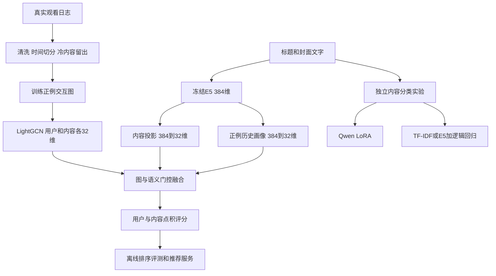

# ClipCompass 技术原理与问题解决详解

ClipCompass 研究一个具体问题：新短视频没有训练期观看反馈时，能否利用标题语义和老用户的兴趣，为它产生有依据的推荐分数，并改善整体排序？项目使用真实 KuaiRec 日志完成数据处理、图推荐、语义融合、离线评测和本地服务；另以 Qwen LoRA 实验验证有限 CPU 预算下的内容文本分类。

阅读目标是能解释每个模型的输入、输出、训练目标、工程取舍，以及实际结果支持什么结论。本文对应 2026 年 10 月 10 日已完成的实验。模型机制与实验数字分别链接到代码、原始报告和官方资料，示意例子不作为实验观测。

目前内容融合尚未证明优于强推荐基线；Qwen LoRA 相对 base 的分类指标改善，但仍弱于现有线性分类对照。推荐与分类是两条独立实验，Qwen 输出没有接入推荐打分。

## 阅读顺序

- [模型分工与整体流程](#模型分工与整体流程)
- [真实数据与观看标签](#真实数据与观看标签)
- [时间划分和冷内容隔离](#时间划分和冷内容隔离)
- [E5 如何把自然语言变成向量](#e5-如何把自然语言变成向量)
- [用户画像与 ID 向量](#用户画像与-id-向量)
- [LightGCN 如何学习协同关系](#lightgcn-如何学习协同关系)
- [图与文字的门控融合](#图与文字的门控融合)
- [BPR 排序训练](#bpr-排序训练)
- [InfoNCE 图与文字对齐](#infonce-图与文字对齐)
- [九种方法与消融设计](#九种方法与消融设计)
- [评测指标与统计方法](#评测指标与统计方法)
- [推荐结果与冷内容平分问题](#推荐结果与冷内容平分问题)
- [Qwen 内容分类任务](#qwen-内容分类任务)
- [LoRA 的参数与监督目标](#lora-的参数与监督目标)
- [CPU 缓存优化与正确性](#cpu-缓存优化与正确性)
- [分类结果与对照边界](#分类结果与对照边界)
- [推荐服务与性能测量](#推荐服务与性能测量)
- [问题处理与未解决事项](#问题处理与未解决事项)
- [代码阅读与复现入口](#代码阅读与复现入口)
- [术语与岗位能力对应](#术语与岗位能力对应)

## 模型分工与整体流程

“BERT 把自然语言变成向量”在项目中的具体对应是 `intfloat/multilingual-e5-small`。文字向量解决了内容表示问题，还需要推荐模型学习用户偏好。

| 模型或方法 | 输入与输出 | 解决的问题 | 本次是否训练 |
|---|---|---|---|
| E5 | 标题和封面文字 → 384 维向量 | 把文字语义变成可计算的表示 | 编码器冻结 |
| BPR-MF | ID 与观看反馈 → 用户和内容各 32 维 | 学习用户与内容的匹配关系 | 是 |
| LightGCN | 用户与内容交互图 → 各 32 维向量 | 利用共同观看带来的协同关系 | 是 |
| 内容门控 | 图表示与文本投影 → 内容推荐向量 | 结合行为与语义，支持内容冷启动 | 是 |
| InfoNCE | 同一内容的两种表示 → 对齐损失 | 尝试使图空间和语义空间一致 | 作为附加目标 |
| Qwen 与 LoRA | 标题及分类指令 → 一个类别代码 | 内容文本分类适配 | 只训练适配器 |
| E5 与逻辑回归 | 384 维向量 → 八类分数 | 检查小分类器是否已经足够 | 只训练分类器 |

BPR、InfoNCE 是训练目标；LoRA 是参数高效微调方法。它们不能与 E5、Qwen 这样的预训练模型混为一谈。



推荐对象是真实短视频，当前输入包括观看行为、标题和数据集提供的人工封面文字。实验没有读取原始视频、提取视觉向量或运行 OCR。用户观看兴趣也只是创作灵感推荐的相关研究基础，不能直接当成创作者意图标签。

## 真实数据与观看标签

### 数据规模

数据来自 KuaiRec 的完整 `small_matrix.csv`。文件名中的 small 指数据集的子集名称，本项目没有再截取前几万行作为研究结果。

| 数据对象 | 数量 |
|---|---:|
| 原始曝光记录 | 4,676,570 |
| 保留首次用户内容曝光后 | 4,494,578 |
| 用户 | 1,411 |
| 内容 | 3,327 |
| 固定留出的冷内容 | 314 |
| 按时间划分的训练记录 | 3,146,204 |
| 验证记录 | 674,187 |
| 测试记录 | 674,187 |
| 移除冷内容后的训练曝光 | 2,850,693 |
| 训练长观看正例 | 133,798 |
| 完整标题表的内容数 | 10,728 |

467 万是曝光记录数，不能说成 467 万个视频，也不能说成 467 万条训练正例。分类实验使用更大的标题表，而推荐目录只有日志涉及的 3,327 个内容。

### 观看标签

`watch_ratio` 表示观看时长相对视频长度的比例。本实验用它构造偏好的代理标签。

| 条件 | 训练用途 | 测试用途 |
|---|---|---|
| `watch_ratio >= 2` | 正例与图中的边 | 正相关内容 |
| `watch_ratio < 1` | 同用户已曝光负例 | 非正例候选 |
| `1 <= watch_ratio < 2` | 不参与 BPR 正负对采样 | 非正例候选 |

长观看可能受到循环播放、视频长度等因素影响。因此标签表达的是长观看代理，不等于点赞、点击率、满意度或创作采纳率。

未曝光不代表不喜欢。训练负例从同一用户确实曝光过但观看比低于 1 的内容中采样，避免把未知偏好直接当作负反馈。不过，曝光本身由旧推荐策略决定，使用真实曝光并未消除选择偏差。

### 首次曝光去重

下面是说明时间泄漏的示意记录：

```text
用户A 视频B 周一 watch_ratio=0.2
用户A 视频B 周五 watch_ratio=3.0
```

如果保留周一的时间，却用两条记录的最大观看比 3.0 作为标签，周五的信息就回流进周一。代码先稳定按时间排序，再按用户和内容去重，同时保留首次时间与首次反馈。代价是舍弃重复消费信息。

标题 CSV 还有 4 处未正确引用的物理换行。解析器将不以记录 ID 开头的续行接回上一行，记录修复数，再严格解析并校验 ID。这个规则针对当前已知数据格式，不能作为任意 CSV 的通用修复器。

来源与校验见 [DATA_SOURCES.md](DATA_SOURCES.md)。数据处理见 [prepare](../clipcompass/research_data.py#L21) 和 [caption_records](../clipcompass/data.py#L21)。

## 时间划分和冷内容隔离

推荐实验在首次曝光去重后，使用全局时间的 70% 和 85% 分位点，把记录分成约 70% 训练、15% 验证、15% 测试。训练时不把验证和测试行为加入图。

冷内容由固定哈希决定：

```text
SHA256("cold-v1:" + 原始video_id)
→ 前4字节按小端解释为整数
→ 对10取余
→ 余数0归入冷内容
```

哈希让不同模型和随机种子共享相同的内容划分。实际留出 314 个内容，约占目录的 9.4%。这些内容的训练标签全部移除，其验证标签也不参与 checkpoint 或方法选择；推理时仍可使用标题。

这里研究的是内容冷启动。用户有可用训练历史，没有验证全新用户的推荐。固定 ID 留出也不等同于真实新发布内容的上线过程。

训练正例矩阵与特征的实际形状如下：

| 张量或矩阵 | 形状或非零数 |
|---|---|
| 用户内容正例矩阵 X | 1411 × 3327，133,798 个非零值 |
| 双向用户内容图 | 4738 × 4738，267,596 条非零边 |
| E5 内容特征 | 3327 × 384 |
| TF-IDF 内容特征 | 3327 × 12000 |
| 用户正例历史语义 | 1411 × 384 |
| 最终用户向量 | 1411 × 32 |
| 最终内容向量 | 3327 × 32 |

标题是数据发布快照，历史版本无法核验；候选目录也没有完整模拟各时刻的内容上线状态。这些限制与行为标签防泄漏是不同问题。完整协议见 [RESEARCH_PROTOCOL.md](RESEARCH_PROTOCOL.md)。

## E5 如何把自然语言变成向量

### 模型选择

使用的模型是 `intfloat/multilingual-e5-small`。本地配置为 `BertModel`，12 层、隐藏维度 384、12 个注意力头。官方模型说明指出它从多语言 MiniLM 初始化，并经过文本表示相关的训练。它具备现成的句子表示能力，适合在有限计算预算下冻结提取特征。

本项目没有重新预训练 E5，也没有证明它在当前数据上是最优编码器。使用多语种模型不等于已经完成跨语言迁移评测。参考 [E5 官方模型说明](https://huggingface.co/intfloat/multilingual-e5-small/raw/main/README.md)。

### 从文字到 token

输入示例：

```text
query: 番茄炒蛋的做法和烹饪技巧
```

`query: ` 遵循 E5 的特征提取约定。文本由 caption 与 manual_cover_text 拼接，不加入类别标签。缺少两类文字时使用“无文本内容”占位。

Tokenizer 把文字切成 token，再映射为词表中的整数 ID。token 不一定等于一个汉字或完整单词；整数编号本身也没有语义上的大小关系。

### Transformer 产生上下文表示

token ID 先通过词嵌入查表获得向量，再经过 Transformer。自注意力的核心为：

$$
\operatorname{Attention}(Q,K,V)=\operatorname{softmax}\left(\frac{QK^\top}{\sqrt{d_k}}\right)V.
$$

Q 可以理解为当前位置寻找的信息，K 用于与其他位置匹配，V 是被加权汇总的信息。编码器可以利用句内双向上下文，因此“苹果”在“手机发布会”和“水果种植”中会形成不同的上下文表示。

一批 B 条文本补齐到 T 个 token 后，E5 输出为：

$$
H\in\mathbb{R}^{B\times T\times384}.
$$

此时每个 token 都有一条向量，还没有得到整句的单个向量。

### 平均池化与归一化

代码排除 padding，对真实 token 的隐藏状态平均：

$$
e=\frac{\sum_{t=1}^{T}m_tH_t}{\sum_{t=1}^{T}m_t},
\qquad m_t\in\{0,1\}.
$$

如果 padding 也参与平均，同一句话可能因同批其他样本的长度不同而改变结果。随后进行 L2 归一化：

$$
\hat e=\frac{e}{\|e\|_2}.
$$

最终每条内容变成 384 个浮点数。各维通常没有“某一维就是美食”的直接含义，语义由整个向量共同表达。对单位向量，点积等于余弦相似度：

$$
\hat e_a^\top\hat e_b=\cos(\theta).
$$

实际编码每批 24 条、最长 128 token，使用 eval 和 inference mode，参数冻结。384 维来自模型结构；128 token 是本次实验截断预算，不是模型架构的最大长度。

预编码缓存按原始 video_id 映射，并核验每条文字的 SHA256，防止标题更新、排序变化或 ID 错位导致特征与内容不匹配。实现见 [embed_texts](../clipcompass/research_data.py#L87) 和 [encode](../clipcompass/research_data.py#L119)。

## 用户画像与 ID 向量

### 从正例文字构造用户画像

设用户 u 在训练期的正例集合为 P_u，最直接的语义画像是：

$$
h_u=\frac{1}{|P_u|}\sum_{i\in P_u}e_i.
$$

E5 历史画像基线将这个均值归一化，再与候选内容做余弦匹配。它表达“用户过去长观看的标题整体在讲什么”。

问题在于语义相似不等于偏好一致。同样是做饭视频，教程节奏、作者吸引力和画面质量可能不同；多个兴趣求均值也会被混合。该画像还没有区分先后顺序、近期和长期兴趣。

### ID Embedding 与矩阵分解

另一种表示来自行为。给每个用户和内容分配随机初始化、可训练的 32 维向量：

$$
p_u\in\mathbb{R}^{32},\qquad q_i\in\mathbb{R}^{32}.
$$

用点积评分：

$$
s(u,i)=p_u^\top q_i.
$$

训练根据观看偏好调整这些数字，使合适的用户和内容得到更高分。BPR-MF 就是用 BPR 目标训练这样的矩阵分解。

| 表示 | 信息来源 | 新内容是否天然可用 |
|---|---|---|
| E5 文本向量 | 预训练语言模型与当前标题 | 有文字即可编码 |
| 内容 ID 向量 | 当前数据中的观看反馈 | 没有行为时缺少学习依据 |
| 用户 ID 向量 | 当前用户的训练反馈 | 当前服务需要已知用户 |

用户历史聚合见 [history_features](../clipcompass/research_train.py#L18)。

## LightGCN 如何学习协同关系

仅靠 ID 向量还可以进一步利用图结构。例如用户甲喜欢视频 A 和 B，用户乙喜欢 B 和 C，两个用户可以通过共同内容 B 传递偏好信息。

先将训练正例矩阵 X 组成二部图：

$$
A=\begin{bmatrix}0&X\\X^\top&0\end{bmatrix}.
$$

初始节点向量包含所有用户和内容，以标准差 0.1 的正态分布初始化。每层传播为：

$$
E^{(l+1)}=D^{-1/2}AD^{-1/2}E^{(l)},
$$

其中 D 是节点度数的对角矩阵。对一个用户展开为：

$$
e_u^{(l+1)}=\sum_{i\in N(u)}\frac{e_i^{(l)}}{\sqrt{|N(u)|\,|N(i)|}}.
$$

含义是聚合邻居表示，同时降低连接很多的节点仅靠数量产生的影响。零度节点的归一化因子设为零，避免除零。

本项目传播两层，平均第 0、1、2 层：

$$
z=\frac{E^{(0)}+E^{(1)}+E^{(2)}}{3}.
$$

第 0 层保留自身表示，第 1 层得到直接交互邻居信息，第 2 层通过共同内容或用户传递协同信息。LightGCN 的传播省略了常规 GCN 的逐层特征变换和非线性激活，保留邻居聚合。参考 [LightGCN 原论文](https://arxiv.org/abs/2002.02126)。

代码使用稀疏矩阵乘法，不需要把整张图存成稠密矩阵。MF 基线复用同一实现但把传播层数设为 0。图中只有训练长观看正例，没有负例边或测试边。

该模型没有使用时序注意力或用户观看序列。两层是固定实验设置，未证明比所有其他深度更好。实现见 [normalized_graph](../clipcompass/research_model.py#L8) 与 [GraphContent](../clipcompass/research_model.py#L18)。

## 图与文字的门控融合

图向量是 32 维，E5 是 384 维。首先学习一个投影，把通用语义转换到当前推荐空间：

$$
c_i=\tanh(W_ce_i+b_c),\qquad W_c\in\mathbb{R}^{32\times384}.
$$

这一步同时完成维度匹配和任务适配；E5 主体依然冻结。把图向量 z_i 与语义向量 c_i 拼接成 64 维，再得到门控：

$$
g_i=\sigma(W_g[z_i;c_i]+b_g).
$$

内容最终向量为：

$$
v_i=g_iz_i+(1-g_i)c_i.
$$

如果 g_i 为 0.8，图表示权重是 80%，语义权重是 20%。该权重由排序损失学习。当前实现是每个内容一个标量门控，不是针对每个用户单独计算的门控，也没有显式输入交互次数。

没有训练正例的内容会屏蔽 ID 向量，同时强制 g_i 为零。这既覆盖预设冷内容，也覆盖其他没有训练正边的内容。于是这些内容只能使用 c_i，防止未经学习的随机 ID 信号参与打分。

用户侧把历史语义均值投影后加到图表示上：

$$
u_u=z_u+\tanh(W_hh_u+b_h).
$$

最后评分：

$$
s(u,i)=u_u^\top v_i.
$$

这让新做饭视频即使没有训练行为，也能凭标题与老用户的偏好向量匹配。融合后向量没有统一做单位长度归一化，所以分数不是概率，也不能默认图分支与语义分支的分数尺度完全一致。

模型能产生冷内容分数，和它能改善排序效果，是两个需要分别验证的问题。

## BPR 排序训练

一个训练样本是三元组 (u, i⁺, i⁻)：同一个用户的一个训练正例和一个已曝光负例。我们希望：

$$
s(u,i^+)>s(u,i^-).
$$

定义分数差：

$$
\Delta=s(u,i^+)-s(u,i^-).
$$

BPR 损失为：

$$
L_{\mathrm{BPR}}=\operatorname{mean}\left[-\log\sigma(\Delta)\right]
=\operatorname{mean}\left[\operatorname{softplus}(-\Delta)\right].
$$

正例 3 分、负例 1 分时损失约 0.127；反过来则约 2.127。这是解释公式的示例。反向传播沿评分路径调整 ID 向量、内容投影、用户画像投影和门控，鼓励正确的相对次序。参考 [BPR 原论文](https://arxiv.org/abs/0905.2779)。

| 设置 | 实际值 |
|---|---|
| 合格用户 | 同时有训练正例与负例，实际 1,411 人 |
| 每轮每用户 | 均匀采样 128 组正负对，允许重复 |
| 每轮总三元组 | 180,608 |
| 每轮优化 | 一次全图前向、反向与 Adam 更新 |
| 更新轮数 | 60 |
| 向量维度 | 32 |
| 学习率 | 0.02 |
| 梯度范数裁剪 | 5 |
| 随机种子 | 42、2024、2025 |
| PyTorch 与 BLAS 线程预算 | 4 |

代码参数叫 `epochs`，报告曾简写为 60 epochs；实际是 60 轮重新采样更新，不是完整遍历全部曝光 60 遍。每用户采样数量相同，使训练目标在用户层面较均衡，而不是完全按曝光量加权。

损失还加入 ID 权重正则：

$$
L=L_{\mathrm{BPR}}+0.001\operatorname{mean}(E_{\mathrm{ID}}^2).
$$

这里显式正则只作用于节点 ID 权重。第 1 轮、每 5 轮及最后一轮在 warm 验证集计算 NDCG@20，保留最优参数。四种神经模型各跑三个种子，共 12 次训练。神经模型类别也仅按三个 seed 的最佳 warm 验证分数均值选择，实际选出 Content SSL。

实现见 [draw_pairs](../clipcompass/research_train.py#L31) 与 [fit](../clipcompass/research_train.py#L40)。

## InfoNCE 图与文字对齐

同一内容有两种视角：图表示描述谁喜欢它，文字表示描述标题在讲什么。Content SSL 在融合模型上增加对比目标，尝试把两者对齐。

每轮最多采样 256 个有训练正例的内容，将图向量与投影后的语义向量归一化，构造：

$$
S_{ij}=\frac{\cos(z_i,c_j)}{\tau},\qquad\tau=0.2.
$$

对角线是同一内容的正配对，其他位置是批内负配对。一个方向的 InfoNCE 为：

$$
L_{g\rightarrow t}=-\frac{1}{B}\sum_i\log\frac{\exp(S_{ii})}{\sum_j\exp(S_{ij})}.
$$

再计算反方向，平均得到：

$$
L_{\mathrm{SSL}}=\frac{L_{g\rightarrow t}+L_{t\rightarrow g}}{2}.
$$

温度控制相似度差异经过 softmax 后的尖锐程度。0.2 是本项目对齐损失的温度，不能与 E5 预训练阶段的设置混淆。完整训练目标为：

$$
L=L_{\mathrm{BPR}}+0.001L_{\mathrm{ID正则}}+0.02L_{\mathrm{SSL}}.
$$

配对标签由同一内容的身份自动产生，不需要额外人工标注，因此是自监督对齐；图表示仍依赖观看反馈，整个推荐任务并非完全无监督。

不同 ID 的内容可能同样在讲做饭，却被作为负配对；协同相似也不一定等于文字相似。这些是可能造成目标冲突的机制，需要通过实验验证，不能仅凭公式断言对齐一定改善推荐。

本次只检验固定权重 0.02 的配置，没有用测试集反复调整。实现见 [semantic_alignment](../clipcompass/research_model.py#L50)。

## 九种方法与消融设计

| 方法 | 做法 | 检验问题 |
|---|---|---|
| Popularity | 按训练正例数排序 | 是否超过简单热门 |
| Smoothed long-watch rate | 正例数除曝光数并平滑 | 是否只是利用了整体内容表现 |
| TF-IDF history | 字符特征与用户正例画像 | 词面匹配能做到什么 |
| E5 history | 冻结语义特征与均值画像 | 不训练投影是否足够 |
| EASE | 闭式内容协同关系 | 是否超过强线性协同基线 |
| BPR-MF | ID 向量点积与 BPR | 图传播前的参照 |
| LightGCN | 两层图传播 | 协同图的贡献 |
| Content Gate | 再加语义投影、用户画像及门控 | 内容融合的效果 |
| Content SSL | 再加图与语义对齐 | 对比目标的额外效果 |

这些比较能研究模块组合，但 Gate 相比 LightGCN 同时增加了内容投影、用户语义画像和门控，不能把差异单独归因于门控函数。所有方法共享协议，固定预算不等于充分超参数搜索。

### TF-IDF

使用字符 1 至 3 gram，最多 12,000 个特征、`min_df=2`、对数词频 `sublinear_tf=True`。例如“番茄炒蛋”会产生单字、相邻双字和三字片段。TF-IDF 根据片段在当前文本和整个语料中的出现情况赋权，属于词面表示。

推荐词表只在训练时段非冷内容上拟合，再变换所有内容。用户正例特征求和后归一化，与内容特征点积排序。分类实验另在其训练内容上拟合词表，不能混用两个拟合范围。

### 平滑长观看率

$$
r_i=\frac{p_i+20\bar r}{e_i+20},\qquad\bar r=\frac{\sum_i p_i}{\sum_i e_i}.
$$

p_i 是训练正例数，e_i 是训练曝光数。加入全局先验可降低“只曝光一次且恰好是正例，就得到 100% 比例”的波动。冷内容没有训练曝光，分数回到同一个全局先验。该方法没有用户个性化，但可能是很强的内容表现基线。

### EASE

EASE 用内容之间的线性关系，从用户已有交互预测其他内容：

$$
\hat X=XB.
$$

带正则的闭式求解为：

$$
P=(X^\top X+\lambda I)^{-1},\qquad B_{ij}=-\frac{P_{ij}}{P_{jj}},\qquad B_{ii}=0.
$$

对角线置零防止简单复制当前输入。项目在 warm 验证集比较 λ 为 100、500、1000，选择了 1000。这个规模可以显式求逆；内容数量大幅增长时，其平方存储和矩阵计算成本需要重新考虑。参考 [EASE 原论文](https://arxiv.org/abs/1905.03375)，实现见 [run](../clipcompass/research_train.py#L88)。

## 评测指标与统计方法

### 候选集合

对每个用户，在指定时间和 warm 或 cold 分组内，排序该用户实际曝光的所有内容。测试没有额外随机抽取未曝光内容当负例。只评估有训练正负历史、并在该测试分组中至少有一个正例的用户。

| 分组 | 评估用户 | 每用户平均候选 | 每用户平均正例 |
|---|---:|---:|---:|
| Warm | 1,396 | 431.46 | 21.85 |
| Cold | 914 | 46.07 | 3.48 |

Cold 候选较少，Top20 覆盖比例更大；两组的 Recall 不能直接横向比较。这是对已有曝光的回顾性排序，不是线上召回策略评测或因果评测。

### Recall 与 NDCG

$$
\operatorname{Recall@20}=\frac{\text{前20名命中的正例数}}{\text{当前候选中的全部正例数}}.
$$

例如一位用户有 5 个正例，前 20 名命中 3 个，Recall 为 0.6。NDCG 进一步考虑正例的位置：

$$
DCG@20=\sum_{r=1}^{20}\frac{rel_r}{\log_2(r+1)},\qquad NDCG@20=\frac{DCG@20}{IDCG@20}.
$$

本次 rel 为二值，理想排序把正例放在前面，最多取 20 个。同样命中三个正例，排在第 1、2、3 位优于第 18、19、20 位。指标先逐用户计算，再求用户均值。

### 多种子与配对 bootstrap

神经模型报告三个 seed 的均值和样本标准差。比较 Gate 与 LightGCN 时，先平均同一用户在三个 seed 下的指标，再计算逐用户差值。对用户有放回抽样 2,000 次，取平均差值的 2.5% 与 97.5% 分位数形成区间。

不能把同一个用户的三个 seed 当作三个独立用户。该区间也不是线上 A/B 的置信结论，只反映当前离线用户样本与模型设定下的差值不确定性。

补充 Joint 评测将 warm 与 cold 曝光候选混合，检查跨分支分数是否可比较，没有根据 Joint 测试结果重新选择 checkpoint 或调参。实现见 [research_eval.py](../clipcompass/research_eval.py) 与 [research_joint_eval.py](../clipcompass/research_joint_eval.py)。

## 推荐结果与冷内容平分问题

以下为 NDCG@20，神经模型使用三个 seed 的均值。完整 Recall、标准差和逐用户记录见 [推荐报告](../artifacts/research/kuairec/REAL_REPORT.md)。

| 方法 | Warm | Cold | Joint |
|---|---:|---:|---:|
| Popularity | 0.16024 | 0.26035 | 0.15656 |
| Smoothed long-watch rate | 0.18479 | 0.26035 | 0.18032 |
| TF-IDF history | 0.06089 | 0.21464 | 0.06404 |
| E5 history | 0.04037 | 0.16351 | 0.03865 |
| EASE | 0.15748 | 0.26035 | 0.15381 |
| BPR-MF | 0.18021 | 0.26035 | 0.17606 |
| LightGCN | 0.18105 | 0.26035 | 0.17718 |
| Content Gate | 0.18133 | 0.24571 | 0.17711 |
| Content SSL | 0.18127 | 0.25800 | 0.17707 |

Gate 相对 LightGCN 的 Warm NDCG 平均差约 +0.00027，配对 95% 区间为 [-0.00078, 0.00137]，跨零；Cold 差值区间为 [-0.02836, -0.00059]。当前配置没有证明融合带来稳定的全面收益。

SSL 的 Cold Recall 为 0.58788，高于 LightGCN 的 0.56898；但 Cold NDCG 为 0.25800，低于 0.26035，Joint 也未胜出。只摘 Cold Recall 的涨幅会遗漏重要结果。

### 相同分数与 ID 顺序

纯 ID 方法没有冷内容的协同信息。MF、LightGCN、EASE 和热门计数在冷内容上给出零分；平滑率给出相同的全局先验分数。主协议按分数降序、内容 ID 升序打破平分，因此这些模型的冷排序实际上由 ID 决定。

| 平分诊断 | Cold Recall@20 | Cold NDCG@20 |
|---|---:|---:|
| ID 升序 | 0.56898 | 0.26035 |
| ID 降序 | 0.33846 | 0.19709 |
| 随机顺序 seed42 | 0.44779 | 0.22062 |
| 随机顺序 seed2024 | 0.44201 | 0.22030 |
| 随机顺序 seed2025 | 0.46329 | 0.22442 |

ID 顺序与该数据上的相关性存在关联，但不能据此断定形成关联的原因。这些分数不能解释为 ID 模型的个性化冷启动能力。处理办法是保留主协议，补充随机和反向顺序诊断，避免通过更换平分规则制造某种方法胜出。

按验证流程选出的神经模型仍是 Content SSL；测试集上平滑长观看率最好，不应据此反复调整模型再继续用同一个测试集证明改进。下一步若验证分数校准、SSL 权重或视觉特征，应建立新的验证与测试安排。结果解读见 [RESULTS_ANALYSIS.md](RESULTS_ANALYSIS.md)。

## Qwen 内容分类任务

### 分类输入和模型结构

分类使用 `Qwen/Qwen2.5-0.5B-Instruct`。本地配置确认：24 层 decoder、隐藏维度 896、14 个 Q 头、2 个 KV 头、FFN 中间维度 4864、词表 151,936，词嵌入与输出头共享。

它是因果语言模型，当前位置可以关注自身及此前 token，不能关注未来 token，并用当前隐藏状态预测下一个 token；E5 编码器则可以利用句内双向上下文。多个 Q 头共享较少的 KV 头，称为分组查询注意力。参考 [Qwen 官方模型说明](https://huggingface.co/Qwen/Qwen2.5-0.5B-Instruct)。

分类输入使用官方 chat template，含系统指令、代码表和标题，期待生成一个类别代码：

```text
类别代码：a=其他；b=情感；c=时尚；d=明星娱乐；
e=民生资讯；f=美食；g=舞蹈；h=颜值
标题：番茄炒蛋的做法和烹饪技巧
类别代码：
```

示意期望回复是 `f`。每个代码都检查为一个 tokenizer token，避免中文类别名称长度不同带来的多 token 训练差异。标题取前 96 个字符，不是 96 token；完整 prompt 超过 384 token 会报错。

系统指令还说明标题只是待分析数据。该约束表达任务意图，没有额外进行提示注入鲁棒性评测。

### 分类数据划分

分类使用完整标题表中的文本与原始一级类别，属于弱标注。去掉文本全部空白并转小写后，对相同文本分组，冲突标签组排除，共涉及 199 条原始记录。

同一组任一内容的 cold-v1 哈希余数为 0，则整组归测试；否则任一余数为 1，则整组归验证；其余归训练。每组保留一条代表。这样精确重复文本不会跨集合，近重复和模板改写仍可能存在。

注意，分类是内容哈希分组划分，不能套用推荐实验的 70/15/15 时间划分。八个类别由训练集频次选取，不覆盖完整内容分类体系。

| 数据用途 | 实际规模 |
|---|---:|
| 训练候选池 | 每类最多100条，共800条 |
| 验证集 | 64条 |
| 测试集 | 160条 |
| 全160步访问的唯一训练内容 | 445条 |
| 最佳第120步访问的唯一训练内容 | 365条 |

每步从 800 条中无放回抽 4 条，不同更新步之间可重复。160 步共呈现 640 个样本位置，并没有遍历全部 800 条。实现见 [build_samples](../clipcompass/research_lora.py#L26) 和 [tokenized_samples](../clipcompass/research_lora.py#L73)。

## LoRA 的参数与监督目标

### 低秩更新

原线性层为 y=W₀x。LoRA 冻结原权重，只学习低秩增量：

$$
y=W_0x+\frac{\alpha}{r}BAx,
\qquad A\in\mathbb{R}^{r\times d_{in}},\quad B\in\mathbb{R}^{d_{out}\times r}.
$$

训练参数从完整矩阵规模缩小为 r(d_in+d_out)。项目只在最后四层，即索引 20、21、22、23 的 q_proj 和 v_proj 上插入 LoRA，r=8、α=16、dropout=0.05，偏置不训练。

每个注意力头维度为 896/14=64。Q 输出 896 维，V 因只有两个 KV 头而输出 128 维，所以实际参数数为：

| 每层模块 | A 形状 | B 形状 | 参数量 |
|---|---|---|---:|
| Q 投影 LoRA | 8 × 896 | 896 × 8 | 14,336 |
| V 投影 LoRA | 8 × 896 | 128 × 8 | 8,192 |

$$
(14,336+8,192)\times4=90,112.
$$

含适配器的总参数是 494,122,880，可训练部分约 0.0182%。基础权重仍然要加载和参与计算，LoRA 节省的是训练参数与相关梯度、优化器状态，不会让基础模型自动消失。当前以 FP32 运行，没有量化，也不是 QLoRA。参考 [LoRA 原论文](https://arxiv.org/abs/2106.09685)。

### 单回复位置的完整词表交叉熵

模型读完 prompt，取最后一个真实 token 的隐藏状态，再经过语言模型输出头：

$$
z=W_{LM}h_{last},\qquad z\in\mathbb{R}^{151936}.
$$

假设正确类别代码 token 为 t_y，训练损失为：

$$
L=-z_{t_y}+\log\sum_{v=1}^{151936}\exp(z_v).
$$

正确代码与完整词表竞争，训练并非仅在八类上计算 softmax。测试分类预测则只在八个代码对应的 logits 中取最大值，另记录全词表首 token 最大值是否属于合法代码。

该训练可以称单回复 token 的监督微调，没有训练解释文本、EOS 或开放式 JSON 生成。首 token 合法率也不保证自由生成时整段输出只有一个代码。

批内输入右侧补齐时，必须根据 attention mask 找到最后一个有效位置，不能直接取张量最后一列。实际优化器为 AdamW、学习率 0.0005、batch size 4、梯度范数裁剪 1、160 次更新、seed42；没有梯度累积或学习率调度器。

验证在第 1 步及每 20 步运行，按 Macro-F1 保留最优适配器参数，最终恢复第 120 步后再测试。实现见 [response_logits](../clipcompass/research_lora.py#L157) 与 [run](../clipcompass/research_lora.py#L191)。

## CPU 缓存优化与正确性

本机约 16GB 内存，i5-1130G7，4 个物理核，没有 NVIDIA GPU。项目采用小模型、冻结表征和减少重复计算的方式完成实验。

### 冻结前二十层的样本缓存

模型可拆成：

$$
h_{20}=f_{frozen}(x),\qquad z=g_{\theta_{LoRA}}(h_{20}).
$$

前二十层、词嵌入和相关位置计算都不训练。相同输入的 h20 不随最后四层 LoRA 更新而变化，因此可以按去掉 padding 后的 token 序列缓存。

首次遇到样本时，冻结前二十层先执行完成，再在索引 20 的层入口通过 forward pre-hook 捕获隐藏状态，中断这次完整模型调用，避免自动继续执行后四层。后续重复样本直接读取缓存。后四层含可训练参数，由训练路径每一步重新计算。冻结前缀的 detach 不会切断最后四层 LoRA 所需的梯度。

### 公共前缀 KV 缓存

所有训练 prompt 的 token 级最长公共前缀实际为 72 token，可包含系统指令、角色标记和固定代码表。因果注意力使这些位置看不到后面的标题，因此它们在冻结层中的 KV 和中间隐藏状态可以复用。

新标题复用公共 KV，只计算新增 token 经过冻结前层的结果。扩展到 batch 时会 clone，避免可变缓存污染公共原件。如果前缀不匹配，代码回退到常规冻结前层计算。

两级缓存的作用不同：公共 KV 减少不同标题重复处理相同指令；完整样本隐藏状态减少同一样本在多步训练中反复执行前二十层。

### 只计算回复位置的词表 logits

最后四层仍需处理完整 prompt，但只有最后有效位置送入语言模型头。若批量 4、序列长 384、词表 151,936，完整 FP32 logits 张量约需 0.93GB；只算最后位置能避免这个大张量。此数字是张量大小估算，不是整个训练进程的峰值内存测量。

### 检查和适用边界

真实 Qwen 训练前，对验证集前两条比较完整与缓存路径的 logits，容差为 atol=0.002、rtol=0.0001。小型 Qwen 单元测试覆盖公共 KV、不同长度、右侧 padding、前向数值一致，以及至少一个 LoRA 参数有非零梯度。

这些检查不是训练后所有参数梯度的逐一等价验证。成立条件包括冻结前层保持不变、前层没有随机 dropout、位置与 mask 语义一致。当前 Qwen 的 attention dropout 为零，LoRA dropout 只在后四层。

实现依赖 Qwen2 内部层接口与 Transformers 4.48.3，张量创建针对 CPU FP32；升级库、换架构、迁移到 GPU 或混合精度时必须重新校验。缓存以额外内存换计算，没有独立有无缓存计时对照，因此不报告加速倍数。

实现与验证见 [PrefixCache](../clipcompass/research_lora.py#L104) 和 [test_lora.py](../tests/test_lora.py)。

## 分类结果与对照边界

### 分类指标与结果

Accuracy 是预测正确的比例。Macro-F1 先计算各类别的精确率 P、召回率 R 和 F1，再对八类平均：

$$
F1_c=\frac{2P_cR_c}{P_c+R_c},\qquad MacroF1=\frac18\sum_{c=1}^{8}F1_c.
$$

它能暴露只擅长少数类别的问题。当前测试集 160 条，结果为：

| 方法 | Accuracy | Macro-F1 |
|---|---:|---:|
| Qwen base prompt | 0.1625 | 0.0367 |
| Qwen LoRA | 0.2188 | 0.1894 |
| TF-IDF 与逻辑回归 | 0.5437 | 0.5302 |
| E5 与逻辑回归 | 0.5813 | 0.5590 |

最佳第 120 步验证 Macro-F1 为 0.2266，第 160 步降为 0.1222，因此不能只保存最后一步。但验证集只有 64 条，不能单凭波动就确认某一种过拟合机制。

Base 在 160 条中把 151 条预测为颜值，存在明显偏置。LoRA 输出更分散，但“其他”和“民生资讯”的测试 F1 仍为零。标题可能缺少舞蹈、颜值等类别所需的视觉线索，标签噪声、预算和类别代码偏好也可能影响效果；当前没有逐项实验归因。

### 线性分类器做了什么

E5 与逻辑回归直接学习：

$$
z=We+b,\qquad W\in\mathbb{R}^{8\times384}.
$$

将八个分数转成类别分布，E5 本体冻结。两种线性基线都使用 balanced 类别权重，在验证集从 C∈{0.1,1,10} 中选择正则参数，实际均选 C=1；C 越小表示更强的正则。

TF-IDF 基线使用字符 1 至 3 gram，词表只在分类训练内容上拟合。E5 基线复用预编码的文本表示。输出分数没有做独立概率校准，不能直接当作可靠置信度。

### 标签预算并不完全相同

现有基线匹配的是整次 160 步 LoRA 运行触达的 445 条唯一内容。但最终选中的第 120 步 adapter 只接触了 365 条，线性基线多使用了 80 条。此外，Qwen 取前 96 个字符，TF-IDF 读取完整文本，E5 最多 128 token。

因此“相同标签访问预算”只能指完整运行层面，不能说最终模型使用完全相同训练集和输入信息。365 可从保存的 seed42、batch size4、800 条训练池复算前 120 次采样的唯一索引数；445 对应前 160 次。

若要严格比较架构，需要预先固定共同训练集合与文本范围后重跑。当前结果使线性方法值得优先考虑，但不能证明在严格匹配条件下它必然优于 LoRA。分类实验还是单 seed、有限测试样本，未报告分类置信区间。

实际新标题推理保留了失败案例：

```text
输入：番茄炒蛋的做法和烹饪技巧
Qwen LoRA：舞蹈
E5与逻辑回归：美食
```

此例来自保存的推理记录，不能替代测试集统计。现有适配说明训练流程有效运转且固定分类指标较 base 改善，还不能证明分类质量已达到应用要求。报告见 [LORA_REPORT.md](../artifacts/research/qwen-lora/LORA_REPORT.md)，基线实现见 [research_lora_baselines.py](../clipcompass/research_lora_baselines.py)。

## 推荐服务与性能测量

训练完成后保存 1411×32 用户向量和 3327×32 内容向量。请求时不重新执行 E5、GNN 或 Qwen，而是：

1. 读取已知用户的向量。
2. 对完整 3,327 内容目录计算点积。
3. 过滤训练与验证阶段已曝光内容。
4. 按请求保留冷内容或全部内容。
5. 稳定排序返回 Top-K、原始 video_id、标题和排序分数。

接口示例为 `GET /recommend?user=0&k=10&cold=true`。user 使用内部索引，k 支持 1 至 100；响应同时给出原始用户 ID。服务绑定本机，使用 Python ThreadingHTTPServer，尚未实现新用户在线更新。

完整点积约需 3327×32=106,464 个维度上的乘加，当前规模可以精确遍历，没有使用 ANN。只计算用户与内容向量内存：

$$
(1411+3327)\times32\times4=606,464\text{ bytes}.
$$

这个数不包含目录文本、Python 对象、已曝光集合或运行时内存。

| 测量条件或指标 | 实际值 |
|---|---|
| 查询数 | 300 |
| BLAS 线程数 | 1 |
| P50 | 1.153 ms |
| P95 | 1.738 ms |
| 测量范围 | 点积、过滤、排序、JSON 对象构建 |
| 不含 | HTTP、序列化传输、编码器和模型加载 |

服务对完整目录检索，而离线指标只对已记录测试曝光候选排序，二者候选范围不同。300 次本地查询也不是生产并发或百万内容检索基准。

发布的服务 checkpoint 是按既定验证流程选择的 `content_ssl_seed42.pt`，不是三个 seed 的集成。实现见 [ResearchEngine](../clipcompass/research_serve.py#L16)，结果见 [serving_benchmark.json](../artifacts/research/kuairec/serving_benchmark.json)。

## 问题处理与未解决事项

| 遇到的问题 | 实际处理 | 当前结论 |
|---|---|---|
| 官方大文件下载慢 | 固定版本镜像，LFS SHA256 与官方 ZIP 条目大小及 CRC 核验 | 文件来源和一致性留档；没有验证整份官方 ZIP 的 MD5 |
| 标题 CSV 非标准换行 | 修复续行并记录审计，严格解析 | 修复 4 处，恢复 10,728 条标题 |
| 重复曝光可能混入未来标签 | 首次时间与反馈一起保留 | 避免这种聚合泄漏，舍弃重复消费信息 |
| 未曝光被误当不喜欢 | 使用已曝光低观看负例 | 仍保留原策略的曝光偏差 |
| 冷内容没有协同向量 | 屏蔽 ID，使用语义投影 | 能计算分数，排序提升未获证实 |
| 384 维与 32 维空间不同 | 学习投影、画像和门控 | 已实现，不保证两个分支自然校准 |
| 缓存文字特征可能错位 | 原始 ID 映射与文本哈希核验 | 推荐特征复用时检测错配 |
| 冷分数相同却出现高指标 | 增加随机及反向平分诊断 | 识别 ID 顺序影响，不修改主协议制造收益 |
| 图与文字对齐可能冲突 | 比较 Gate 与 SSL，保留负结果 | 固定权重结果不能证明方法普遍无效 |
| CPU 微调重复计算高 | 公共 KV、冻结隐藏状态缓存、单位置 logits | 完成实际训练并做数值检查，没有倍数加速结论 |
| LoRA 弱于简单分类对照 | 强基线与逐类错误分析 | 质量不足的具体原因尚未逐项验证 |
| 分类训练集合不完全匹配 | 核实 365 与 445 条的差异 | 严格共同训练集对照仍待执行 |

已有 20 项测试通过，覆盖首次曝光与冷边隔离、未来测试标签不改变训练、已曝光负例采样、图归一化、指标已知答案、bootstrap、CSV 修复、LoRA 缓存和梯度等关键路径。单元测试确认实现符合相应约束，不替代模型质量或业务收益证据。

后续可研究分支校准、不同 SSL 权重、真实视觉特征和更公平的分类对照。这些属于待验证假设，需要独立数据安排；已经查看过的测试集不应继续被用作调参目标。

## 代码阅读与复现入口

按以下顺序阅读，可把公式与实际调用串起来：

| 阅读文件 | 应该回答的问题 |
|---|---|
| [research_data.py](../clipcompass/research_data.py) | 原始数据如何变成事件、目录、图边和文本特征 |
| [research_model.py](../clipcompass/research_model.py) | 图传播、门控和 InfoNCE 怎样计算 |
| [research_train.py](../clipcompass/research_train.py) | 如何采样、更新、比较基线和选择 checkpoint |
| [research_eval.py](../clipcompass/research_eval.py) | 候选、指标和 bootstrap 的准确口径 |
| [research_joint_eval.py](../clipcompass/research_joint_eval.py) | warm 与 cold 混排如何评估 |
| [audit_cold_ties.py](../tools/audit_cold_ties.py) | 相同分数怎样影响冷启动结论 |
| [research_lora.py](../clipcompass/research_lora.py) | 分类数据、单 token 目标和缓存如何连接 |
| [research_lora_baselines.py](../clipcompass/research_lora_baselines.py) | 如何复原运行标签预算和训练线性对照 |
| [research_serve.py](../clipcompass/research_serve.py) | 冻结向量怎样变成推荐接口 |
| [tests](../tests) | 哪些约束通过测试检查 |

环境安装、固定模型版本下载、训练和服务命令见 [RESEARCH_RUNBOOK.md](RESEARCH_RUNBOOK.md)。本次讲解使用已有实验，没有为撰写文档重新训练。原始 JSON 和权重保留原始实验事实，文档对预算与 epoch 的说明不代表新增结果。

## 术语与岗位能力对应

| 术语 | 在这里的具体含义 |
|---|---|
| Token | 分词器处理的离散文字单元 |
| Embedding | 用一串浮点数表示 token、用户或内容 |
| Pooling | 把多个 token 表示聚合为一句话的表示 |
| 冻结 | 参数不参与当前训练更新 |
| 协同过滤 | 从用户与内容行为关系学习匹配 |
| 冷启动 | 当前内容缺少可用训练行为 |
| Learning to Rank | 根据偏好监督学习排序，本次使用 BPR |
| 对比学习 | 拉近正确配对、相对区分其他配对 |
| Prompt | 给预训练语言模型的任务指令和输入格式 |
| SFT | 使用目标回复进行监督微调，本次只有一个类别回复 token |
| LoRA | 冻结原权重并学习低秩更新 |
| Checkpoint | 某次更新后保存的模型参数 |
| 消融 | 移除或增加模块，检查组合效果变化 |
| Bootstrap | 对样本重采样，估计统计量不确定性 |

| JD 方向 | 已完成内容 | 尚未覆盖的范围 |
|---|---|---|
| NLP 与内容理解 | E5 标题表示、八类文本分类 | 原始视频理解 |
| 图神经网络 | 两层 LightGCN 二部图传播 | 大规模分布式图训练 |
| Learning to Rank | 已曝光正负对 BPR | 线上策略与因果收益 |
| 自监督与对比学习 | 图与文本双向 InfoNCE | 完整自监督预训练 |
| Prompt 与 Fine-tuning | Qwen 单回复 token LoRA | 连续预训练与本项目真实蒸馏实验 |
| 模型加速 | 冻结层缓存和离线向量评分 | 通用 GPU 加速或量化结论 |
| 多语种 | 使用多语种编码器 | 跨语种迁移效果验证 |
| MLLM | 保留旧接口和配置供扩展 | 当前真实实验没有 MLLM 训练 |

简历与面试表述见 [RESUME.md](RESUME.md) 和 [INTERVIEW.md](INTERVIEW.md)。旧合成演示与尚未实跑的扩展接口见 [LEGACY_DEMO.md](LEGACY_DEMO.md)，不能作为上述真实研究结果的证据。
